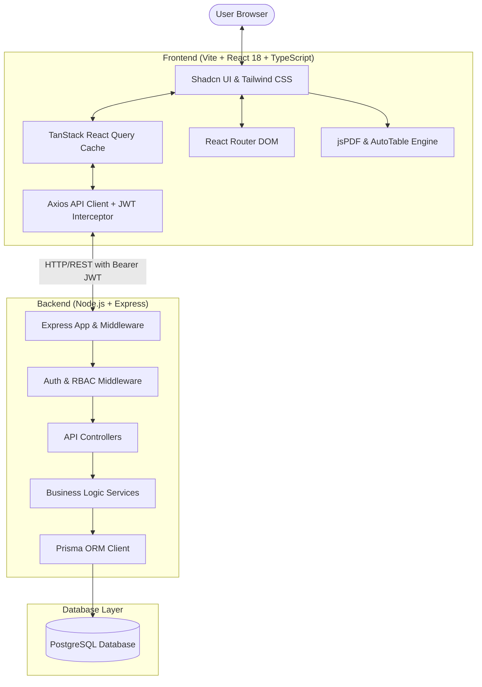
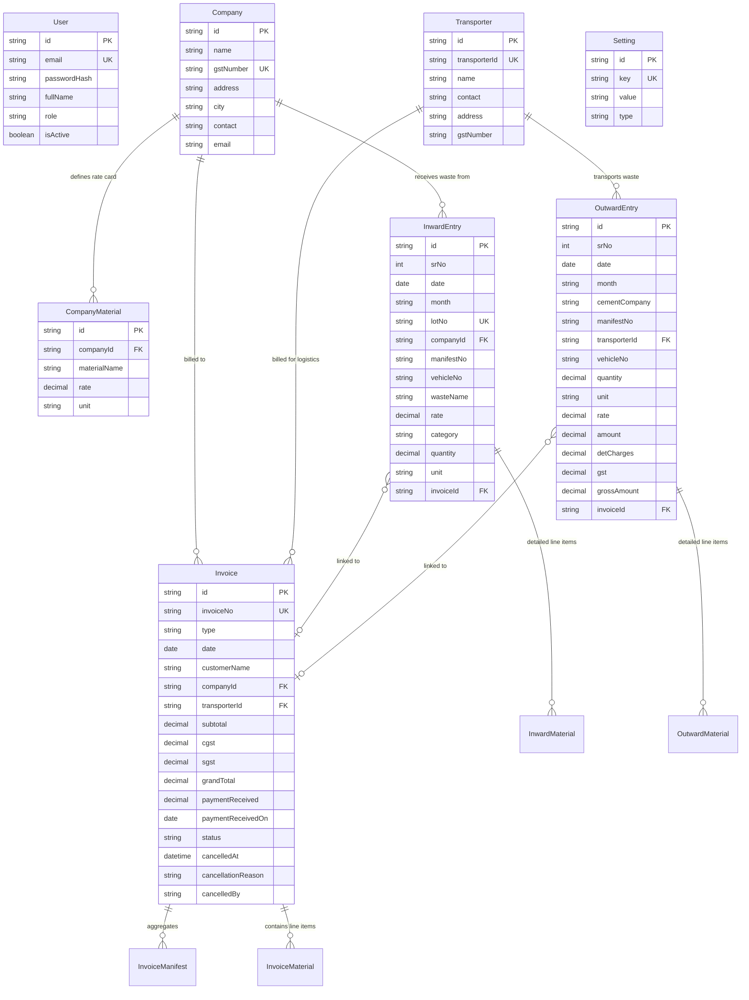
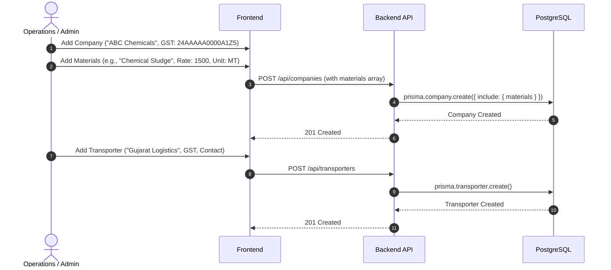
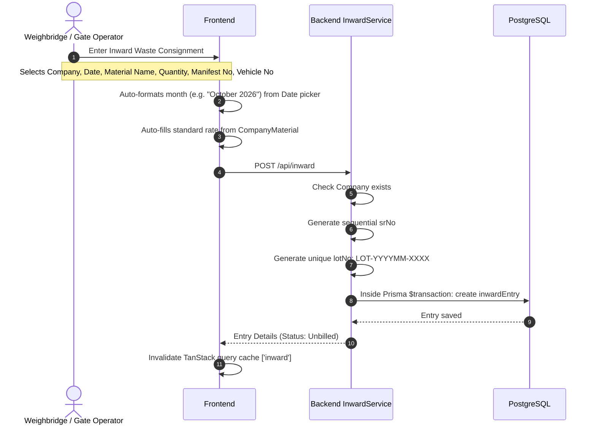
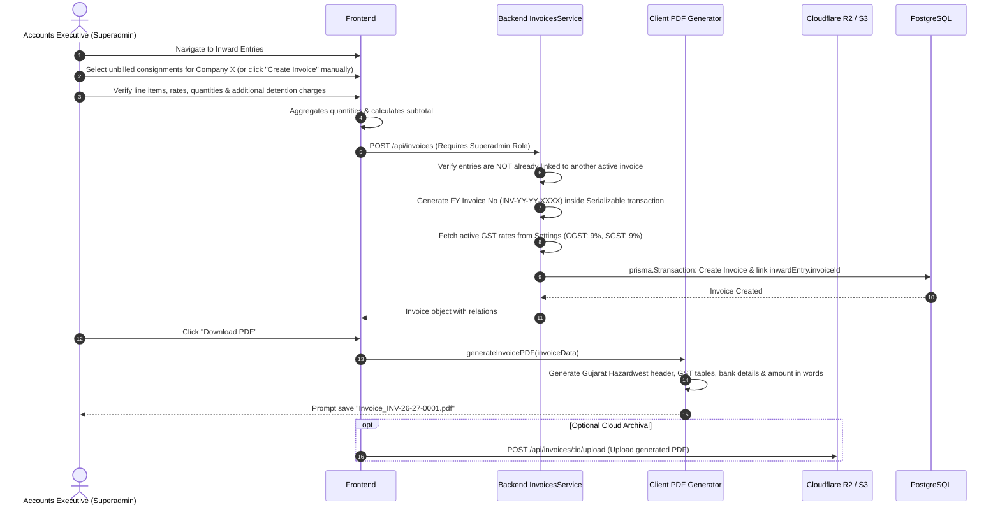
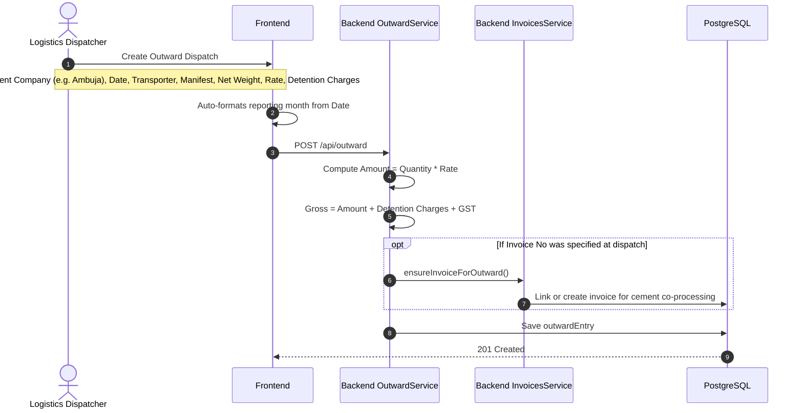
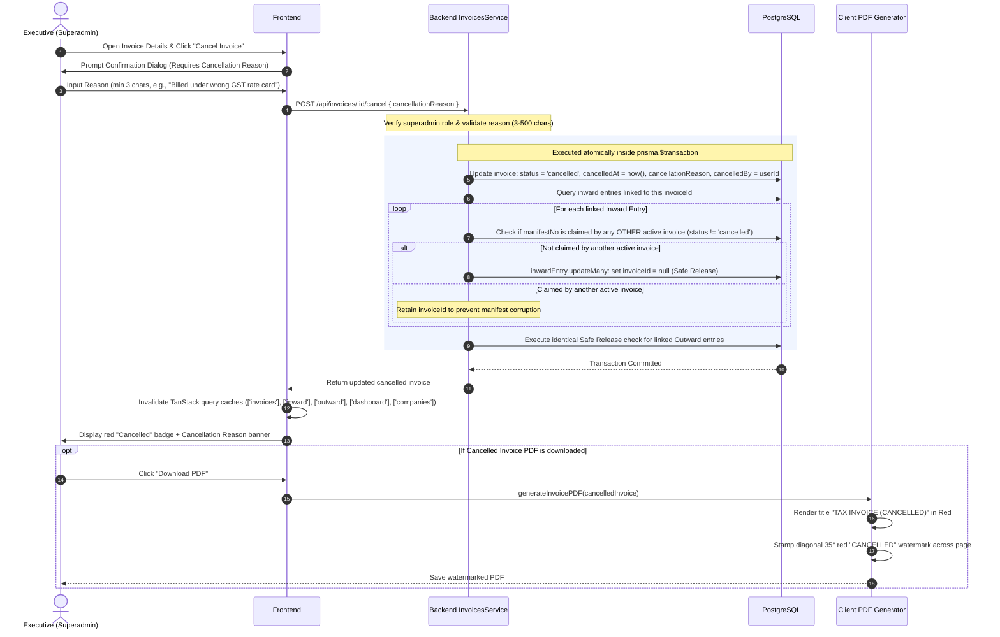

# Gujarat Hazardwest Management Co. (GHMC)
## Complete Technical Architecture, Workflow & Developer Guide

---

## 1. Executive Summary & Core Objective

### 1.1 What is this Project?
This system is an **Enterprise Resource Planning (ERP) & Compliance Platform** built specifically for **Gujarat Hazardwest Management Co. (GHMC)**. The company operates in the hazardous and chemical waste management sector in Gujarat, India.

In this industry, handling industrial hazardous waste is subject to strict environmental regulations (such as PCB/CPCB manifest tracking), complex logistics (transporting hazardous materials safely), and specialized commercial agreements (rate cards per waste material type, detention fees, and Indian GST tax rules).

### 1.2 Main Objectives of the Application
1. **Inward Logistics & Waste Intake Tracking**:
   - Record waste consignments received from client chemical manufacturing companies.
   - Capture critical statutory parameters: **Manifest Numbers**, **Vehicle Numbers**, **Lot Numbers**, **Waste Categories**, **Units**, and **Quantities**.
   - Dynamically bind and format reporting months based on consignment receipt dates.
   - Automatically match pre-agreed waste material rates for each client company.
2. **Outward Logistics & Co-Processing Dispatch**:
   - Track hazardous waste dispatched from the facility to cement manufacturing plants (such as Ambuja, UltraTech, etc.) for high-temperature incineration/co-processing.
   - Record logistics transporters, vehicle capacities, driver detention charges, and dispatch manifests.
   - Dynamically bind dispatch months to consignment dates.
3. **Automated Billing & Indian GST Invoicing**:
   - Generate official Tax Invoices for Inward processing fees and Outward dispatch charges.
   - Dynamically compute Subtotals, CGST (9%), SGST (9%), IGST, and Grand Totals.
   - Follow Indian Financial Year sequencing (e.g., `INV-26-27-0001` starting April 1st) with thread-safe concurrency handling.
   - Generate pixel-perfect downloadable PDF tax invoices with company letterhead, bank details, and amounts in words (Indian numbering system: Lakhs/Crores).
   - Support direct cloud PDF archiving (Cloudflare R2 / AWS S3 storage).
4. **Financial Reconciliation, Payment Tracking & Cancellation Safeguards**:
   - Track received payments against invoices with automatic balance reconciliation (`Pending` ➔ `Partial` ➔ `Paid`).
   - Prevent financial leaks via a strict **Super-Admin Invoice Cancellation Workflow** with mandatory reason logging, payment locks, and watermarked PDF outputs.
   - Intelligently and safely release unbilled Inward/Outward consignments (`invoiceId = null`) upon invoice cancellation, returning them to the billing pool without breaking shared-manifest references.
5. **Operational Analytics**:
   - Provide a real-time dashboard consolidating total tonnage received and dispatched (normalizing Kilograms, Metric Tonnes, and Kilolitres into MT), monthly revenues, and outstanding receivables—with automated filtering that excludes cancelled invoices from financial metrics.
6. **Role-Based Access Control (RBAC)**:
   - Establish strict operational separation between standard operators (`admin`: weighbridge intake, dispatches, viewing records) and executives (`superadmin`: invoice creation, payment recording, cancellation, and master overrides).

---

## 2. High-Level Architecture

The project is structured as a decoupled, modern full-stack web application:



### 2.1 Technology Stack Summary

| Layer | Technologies Used | Key Libraries & Packages |
|---|---|---|
| **Frontend** | React 18, TypeScript, Vite | Tailwind CSS, Radix UI (via Shadcn), TanStack React Query v5, React Router v6, Axios, Lucide React, jsPDF, jspdf-autotable, date-fns, sonner |
| **Backend** | Node.js (ES Modules), Express | Prisma ORM, PostgreSQL, jsonwebtoken (JWT), bcryptjs, Joi, helmet, cors, compression, express-rate-limit, morgan, multer |
| **Cloud Storage** | Cloudflare R2 / AWS S3 API | `@aws-sdk/client-s3`, `@aws-sdk/s3-request-presigner` (for direct invoice PDF archiving & download presigning) |
| **Database** | PostgreSQL | Prisma Schema (`backend/prisma/schema.prisma`) with migrations |
| **Authentication & RBAC** | JWT (JSON Web Tokens) & RBAC Middleware | Bearer token in `localStorage`, role enforcement (`admin` vs `superadmin`) per route |

---

## 3. Database Schema & Domain Entity Relationships

The data model is defined in `backend/prisma/schema.prisma`. Below is the entity relationship diagram:



### 3.1 Key Entity Breakdown
- **`User`**: System actors. Roles include:
  - `admin`: Standard operational staff with permissions to record intake consignments, log outward dispatches, manage company/transporter masters, view reports, and download invoice PDFs.
  - `superadmin`: High-privilege role with exclusive authorization to generate invoices, edit commercial terms, record payments, cancel invoices, and delete invoice records.
- **`Company`**: Clients who produce hazardous waste. Identified by unique GST number.
- **`CompanyMaterial`**: Preset master pricing. When an inward entry is created for Company X with Material Y, the rate is automatically pulled from here.
- **`Transporter`**: Third-party logistics partners who move waste between GHMC and cement plants.
- **`InwardEntry`**: Gate intake records of incoming waste. Each has an auto-generated serial number (`srNo`), a monthly lot number (e.g., `LOT-202609-0001`), and an automatically synchronized `month` field (e.g., `October 2026`) formatted from the receipt date.
- **`OutwardEntry`**: Dispatch records sent to cement kilns for co-processing. Tracks destination cement company, vehicle numbers, freight, detention charges, and dynamically formatted dispatch `month`.
- **`Invoice`**: The commercial billing document. Ties to either a `Company` (Inward waste treatment) or a `Transporter` (Outward logistics).
  - Stores tax splits (`cgst`, `sgst`), line items, and payment reconciliation (`paymentReceived`, `status`).
  - **Status Lifecycle**: `Pending` ➔ `Partial` ➔ `Paid` or `cancelled`.
  - **Cancellation Audit Fields**: `cancelledAt` (timestamp of cancellation), `cancellationReason` (mandatory explanation, min 3 chars), and `cancelledBy` (user ID of the cancelling superadmin).
  - **Safe Release Trigger**: When an invoice is cancelled, all inward and outward entries linked solely to this invoice are automatically unlinked (`invoiceId = null`), instantly returning them to the unbilled pool for future billing.
- **`InvoiceManifest` & `InvoiceMaterial`**: Sub-items and manifests included in an invoice.
- **`Setting`**: System configuration store (e.g., `cgst_rate`, `sgst_rate`, `invoice_number_format`, company address/bank details).

---

## 4. End-to-End Business Workflows

### Workflow 1: Master Data Setup

*Purpose*: Inward and outward entries rely on this master data to auto-populate customer details, rates, and tax identifiers.

---

### Workflow 2: Inward Waste Entry Lifecycle


---

### Workflow 3: Invoicing & Billing Lifecycle

*Note on Invoice Number Generation*:
Invoice numbering strictly adheres to Indian Financial Year formats (e.g. `INV-26-27-0001` starting April 1st). The generator uses a `Serializable` transaction with an automatic retry mechanism (up to 5 attempts) to handle concurrent invoice creations gracefully without duplicate key (`P2002`) collision errors.

---

### Workflow 4: Outward Entry & Cement Plant Co-Processing


---

### Workflow 5: Payment Tracking & Reconciliation
- **Role Requirement**: Only users with the `superadmin` role are permitted to record or adjust invoice payments (`PUT /api/invoices/:id/payment`). Standard `admin` users have read-only access.
- Invoices start with status `Pending` (`paymentReceived = 0`).
- When payment is received from a client or paid to a transporter, the superadmin opens the invoice on the **Invoices** page and clicks **Edit Payment**.
- The user inputs the amount and the payment date.
- **Backend Safeguards & Logic** in `backend/src/services/invoices.service.js`:
  ```javascript
  // 1. Rejection safeguard against cancelled invoices
  if (invoice.status === 'cancelled') {
    throw new ValidationError('Cannot record payment for a cancelled invoice');
  }

  // 2. Automatic status transition
  const grandTotal = parseFloat(invoice.grandTotal);
  let status = 'Pending';
  if (paymentReceived >= grandTotal) {
    status = 'Paid';
  } else if (paymentReceived > 0) {
    status = 'Partial';
  }
  ```
- The invoice status instantly updates on the UI and is reflected on the **Dashboard** metrics.

---

### Workflow 6: Invoice Cancellation & Consignment Safe Release (Super-Admin Feature)

In commercial operations, invoices may need to be cancelled due to billing rate adjustments, incorrect quantity entries, or client cancellations. The system implements a robust, audited cancellation workflow with automatic consignment safe release.



#### Detailed Breakdown of Cancellation Mechanics:
1. **Security & Authorization**:
   - The cancellation endpoint `POST /api/invoices/:id/cancel` is protected by `authorize(['superadmin'])`.
   - In the frontend, the "Cancel Invoice" button is rendered **only** when `user.role === 'superadmin'` and `invoice.status !== 'cancelled'`. Standard `admin` users cannot see or trigger cancellation.
2. **Mandatory Audit Logging**:
   - Every cancellation requires a reason (`cancellationReason`: 3 to 500 characters).
   - The invoice retains full audit metadata: `cancelledAt` (exact timestamp), `cancellationReason` (explanation), and `cancelledBy` (ID of the superadmin user).
3. **Safe Consignment Release Algorithm**:
   - Simply deleting an invoice or blindly setting foreign keys to null could corrupt consignments shared across multi-manifest bills.
   - The backend checks each linked `InwardEntry` and `OutwardEntry`. If its `manifestNo` is **not** referenced by any other active (non-cancelled) invoice, the entry is freed (`invoiceId = null`).
   - These consignments immediately reappear as **Unbilled** on the Inward/Outward screens, allowing operators to create a corrected invoice without re-entering consignments or weighbridge slips.
4. **Exclusion from Financial Metrics & Reports**:
   - Cancelled invoices are strictly filtered out (`status: { not: 'cancelled' }`) across all system calculations:
     - Dashboard total revenue, monthly revenue charts, and outstanding payment distributions.
     - Company-level billing aggregates and pending balances.
     - Transporter invoice and payment summaries.
     - Invoices statistics overview (`/api/invoices/stats`).
5. **PDF Watermarking & Legal Compliance**:
   - Cancelled invoices remain permanently preserved in the database for auditing purposes.
   - When exported or viewed as PDF, the header prints in bold red: `TAX INVOICE (CANCELLED)`, and a prominent `CANCELLED` diagonal watermark is stamped across the body of the invoice to prevent misuse.

---

## 5. Complete Codebase Directory Map

### 5.1 Backend Structure (`/backend`)
```
backend/
├── prisma/
│   ├── schema.prisma               # Database schema definition (PostgreSQL)
│   └── migrations/                 # Version-controlled SQL migration history
├── src/
│   ├── app.js                      # Express configuration, middleware, route mounting
│   ├── server.js                   # Server bootstrap & port listener (default: 3000)
│   ├── config/
│   │   ├── database.js             # PrismaClient singleton instance
│   │   └── env.js                  # Environment variables & runtime validation
│   ├── controllers/                # HTTP layer: extracts req params/body, delegates to services
│   │   ├── auth.controller.js
│   │   ├── companies.controller.js
│   │   ├── dashboard.controller.js
│   │   ├── invoices.controller.js  # Includes cancelInvoice & uploadInvoice handlers
│   │   ├── inward.controller.js
│   │   ├── outward.controller.js
│   │   ├── settings.controller.js
│   │   └── transporters.controller.js
│   ├── routes/
│   │   └── invoices.routes.js      # RBAC-protected routes (superadmin required for mutations)
│   ├── services/                   # Business Logic Layer: queries, transactions, calculations
│   │   ├── auth.service.js         # JWT signing, user creation, password verification
│   │   ├── companies.service.js    # Company CRUD & material rate card management
│   │   ├── dashboard.service.js    # Metrics calculation (MT conversion, revenue excluding cancelled)
│   │   ├── invoices.service.js     # FY sequence generation, tax calculation, safe release cancellation
│   │   ├── inward.service.js       # Inward entry creation, LOT number sequence generator
│   │   ├── outward.service.js      # Outward entry creation, freight/detention calculation
│   │   ├── settings.service.js     # Key-value system config
│   │   └── transporters.service.js # Transporter fleet & GST profile management
│   ├── middleware/
│   │   ├── auth.middleware.js      # JWT Bearer verification
│   │   ├── role.middleware.js      # RBAC verification (admin vs superadmin)
│   │   ├── error.middleware.js     # Global error catcher & standardized error response
│   │   └── logger.middleware.js    # Request logger
│   ├── seeders/
│   │   ├── admin.seeder.js         # Seeds default admin (admin@ghmcwest.com / admin123)
│   │   ├── superadmin.seeder.js    # Seeds default superadmin (superadmin@ghmcwest.com / superadmin123)
│   │   └── settings.seeder.js      # Seeds default GST rates & invoice formats
│   └── utils/
│       ├── errors.js               # Custom error classes (NotFoundError, ValidationError, ConflictError)
│       ├── math.js                 # Decimal rounding & precision handlers
│       ├── validators.js           # Joi schemas (including cancelInvoiceSchema)
│       └── logger.js               # Structured console logger
```

### 5.2 Frontend Structure (`/frontend`)
```
frontend/
├── src/
│   ├── App.tsx                     # Top-level routing, React Query Provider, Auth Provider
│   ├── main.tsx                    # React DOM entry point
│   ├── index.css                   # Global Tailwind CSS and badge styles (.status-cancelled)
│   ├── lib/
│   │   ├── api.ts                  # Central Axios client with JWT request interceptor & 401 redirect
│   │   └── utils.ts                # Tailwind class merge utility (cn)
│   ├── contexts/
│   │   └── AuthContext.tsx         # User authentication state, token persistence, role exposure
│   ├── pages/                      # Page components
│   │   ├── Login.tsx               # Credentials authentication
│   │   ├── Dashboard.tsx           # Metrics cards, monthly charts, recent transactions
│   │   ├── Companies.tsx           # Company master table, material management dialog
│   │   ├── Inward.tsx              # Inward entries table, new entry modal, dynamic month binding
│   │   ├── Outward.tsx             # Outward dispatch table, dispatch modal, dynamic month binding
│   │   ├── Transporters.tsx        # Transporter master table & registration modal
│   │   ├── Invoices.tsx            # Invoice list, cancellation dialog, reason alert, PDF download
│   │   └── Settings.tsx            # System settings (GST rates, FY prefix, profile)
│   ├── components/
│   │   ├── auth/ProtectedRoute.tsx # Route guard checking authentication and user roles
│   │   ├── layout/                 # MainLayout, Header (with user menu), Sidebar (navigation)
│   │   ├── common/                 # StatusBadge (supports cancelled), CreateInvoiceModal, ConfirmDialog
│   │   └── ui/                     # Shadcn UI primitives (Button, Dialog, Input, Table, etc.)
│   ├── services/                   # API caller services (mirror backend controllers)
│   │   ├── auth.service.ts
│   │   ├── companies.service.ts
│   │   ├── dashboard.service.ts
│   │   ├── invoices.service.ts     # invoiceService.cancelInvoice(id, reason)
│   │   ├── inward.service.ts
│   │   ├── outward.service.ts
│   │   ├── settings.service.ts
│   │   └── transporters.service.ts
│   └── utils/
│       ├── pdfGenerator.ts         # jsPDF tax invoice generator with CANCELLED watermark
│       ├── export.ts               # CSV export utility for tabular data
│       ├── formatCurrency.ts       # Indian currency formatter (₹ and comma conventions)
│       └── validation.ts           # GSTIN, phone, email, and numeric format validators
```

---

## 6. How the Modules Work Together

```
+-----------------------------------------------------------------------------------+
|                                 MASTER DATA LAYER                                 |
|                                                                                   |
|  [ Companies ]                                                [ Transporters ]    |
|   - Company Profile                                            - Transporter Info |
|   - Waste Materials & Pre-set Rates                             - Vehicle Metadata |
+-------------------------+---------------------------------------------+-----------+
                          |                                             |
                          | (Auto-populates rates)                      | (Assigned to)
                          v                                             v
+-------------------------+-----------+         +-----------------------+-----------+
|      INWARD OPERATIONS              |         |     OUTWARD OPERATIONS            |
|                                     |         |                                   |
| - Receives hazardous waste          |         | - Dispatches waste to cement kilns|
| - Auto-syncs month from date        |         | - Auto-syncs month from date      |
| - Generates LOT-YYYYMM-XXXX         |         | - Records quantity & rate         |
| - Unbilled pool holds free entries  |         | - Records detention charges       |
+-------------------------+-----------+         +-----------------------+-----------+
                          |                                             ^
                          | (Selected for billing)                      | (Safe release)
                          v                                             |
+-----------------------------------------------------------------------+-----------+
|                           INVOICING & TAXATION ENGINE                             |
|                                                                                   |
| - Superadmin creates invoices (FY format: INV-YY-YY-XXXX)                         |
| - Calculates Subtotal, CGST (9%), SGST (9%), Grand Total                          |
| - Client-side PDF generation (official letterhead & words in Rupees)              |
|                                                                                   |
| [ CANCELLATION & SAFE RELEASE ]                                                   |
| - Superadmin cancels invoice with mandatory reason                                |
| - Unlinks consignments (invoiceId = null) if not claimed by other active bills    |
| - Returns consignments back to Unbilled pool for re-invoicing                     |
| - Stamped with diagonal red CANCELLED watermark on PDF exports                    |
+-----------------------------------------------+-----------------------------------+
                                                |
                                                | (Active bills only: status != 'cancelled')
                                                v
+-----------------------------------------------+-----------------------------------+
|                           PAYMENT & RECONCILIATION                                |
|                                                                                   |
| - Superadmin records payments (Blocked on cancelled invoices)                     |
| - Auto-updates Status: Pending -> Partial -> Paid                                 |
| - Feeds real-time financial stats to the Dashboard (Cancelled excluded)          |
+-----------------------------------------------------------------------------------+
```

---

## 7. Developer's Code Modification Guide ("When You Change Code...")

Follow these precise rules and workflows whenever you modify or extend this system:

### Rule 1: Adding a New Field to an Existing Entity (e.g., adding `driverPhone` to `InwardEntry`)
1. **Database Schema**:
   - Open [backend/prisma/schema.prisma](file:///e:/Codes/GHMC/backend/prisma/schema.prisma).
   - Add the field: `driverPhone String? @map("driver_phone")`.
   - Run migration:
     ```bash
     cd backend
     npx prisma migrate dev --name add_driver_phone_to_inward
     npx prisma generate
     ```
2. **Backend Service & Controller**:
   - Open [backend/src/services/inward.service.js](file:///e:/Codes/GHMC/backend/src/services/inward.service.js).
   - In `createEntry(entryData)` and `updateEntry(entryId, entryData)`, destructure `driverPhone` and include it in the `prisma.inwardEntry.create` / `update` call.
   - If search needs to include it, add `{ driverPhone: { contains: search, mode: 'insensitive' } }` to the `OR` conditions.
3. **Frontend Service & Types**:
   - Open [frontend/src/services/inward.service.ts](file:///e:/Codes/GHMC/frontend/src/services/inward.service.ts).
   - Add `driverPhone?: string;` to `InwardEntry` and `CreateInwardEntryDto`.
4. **Frontend Form & Table**:
   - Open [frontend/src/pages/Inward.tsx](file:///e:/Codes/GHMC/frontend/src/pages/Inward.tsx).
   - Add input field in the create/edit Dialog.
   - Add table column if you want it displayed in the list.

### Rule 2: Invalidation of TanStack Query Caches
Whenever you perform a **mutation** (create, update, delete) on the frontend, you must invalidate the corresponding TanStack query key. Otherwise, the UI will display stale data.
- Inward entries: `queryClient.invalidateQueries({ queryKey: ['inward'] })`
- Outward entries: `queryClient.invalidateQueries({ queryKey: ['outward'] })`
- Invoices: `queryClient.invalidateQueries({ queryKey: ['invoices'] })`
- Companies: `queryClient.invalidateQueries({ queryKey: ['companies'] })`
- Transporters: `queryClient.invalidateQueries({ queryKey: ['transporters'] })`
- Dashboard metrics: `queryClient.invalidateQueries({ queryKey: ['dashboard'] })`

### Rule 3: Handling Numeric Precision & Currency
- In the backend, monetary fields and quantities are stored as Prisma `Decimal` with `@db.Decimal(10, 2)`.
- Always use the helper in [backend/src/utils/math.js](file:///e:/Codes/GHMC/backend/src/utils/math.js) (`roundValue(val)`) before persisting calculated amounts to prevent floating-point calculation bugs.
- In the frontend, format all displayed currency using `formatCurrency(val)` from [frontend/src/utils/formatCurrency.ts](file:///e:/Codes/GHMC/frontend/src/utils/formatCurrency.ts).

### Rule 4: Preserving Database Transactions
- Critical operations (such as generating an invoice and linking multiple inward entries, or generating a sequential `srNo` and `lotNo`) **must** be executed inside `prisma.$transaction(async (tx) => { ... })`.
- Never split multi-record billing updates into separate unawaited queries.

### Rule 5: Modifying Invoices or PDF Layouts
- The PDF is generated in the browser using `jspdf` and `jspdf-autotable` inside [frontend/src/utils/pdfGenerator.ts](file:///e:/Codes/GHMC/frontend/src/utils/pdfGenerator.ts).
- If you add fields to invoices (e.g. Purchase Order numbers, extra tax lines, or remarks), you must update `generateInvoicePDF()` to include the new table columns or metadata blocks.
- **Cancellation Watermark Handling**:
  ```typescript
  const isCancelled = (invoiceData.status || '').toLowerCase() === 'cancelled';
  if (isCancelled) {
    doc.setTextColor('#DC2626');
    doc.text('TAX INVOICE (CANCELLED)', 105, 38, { align: 'center' });
    doc.setFontSize(40);
    doc.text('CANCELLED', 105, 150, { align: 'center', angle: 35 });
  }
  ```

### Rule 6: Financial Aggregations Must Filter Out Cancelled Invoices
Whenever writing backend queries that calculate billing totals, revenue summaries, payments received, or active entry associations, you **must** explicitly include `status: { not: 'cancelled' }`. Failing to do so will distort corporate financial statements:
```javascript
// Correct pattern for financial summaries
const activeInvoices = await prisma.invoice.aggregate({
  where: {
    type: 'Inward',
    status: { not: 'cancelled' }, // Mandatory filter
    date: { gte: startOfMonth },
  },
  _sum: { grandTotal: true, paymentReceived: true },
});
```

### Rule 7: Role-Based Authorization & Endpoint Protection
Maintain strict separation of responsibilities between operations and financial control:
- **Operational routes** (readings, gate entries, dispatches, master setup):
  ```javascript
  router.get('/', authenticate, authorize(['superadmin', 'admin']), controller.getAll);
  ```
- **Financial mutations** (invoice creation, payment adjustment, cancellation, deletion):
  ```javascript
  router.post('/:id/cancel', authenticate, authorize(['superadmin']), validate(cancelInvoiceSchema), controller.cancelInvoice);
  ```
- **Frontend UI guarding**:
  Always check `user?.role === 'superadmin'` before rendering action triggers like **Cancel Invoice**, **Edit Payment**, or **Delete**.

### Rule 8: Synchronizing Consignment Date and Reporting Month
Inward and Outward consignment forms require both exact date and formatted monthly buckets for reporting. Always bind the `month` field dynamically using `date-fns`:
```typescript
useEffect(() => {
  if (formData.date) {
    const dateObj = new Date(formData.date);
    if (!isNaN(dateObj.getTime())) {
      const formattedMonth = format(dateObj, 'MMMM yyyy');
      if (formData.month !== formattedMonth) {
        setFormData(prev => ({ ...prev, month: formattedMonth }));
      }
    }
  }
}, [formData.date]);
```

---

## 8. Common Developer Commands & Operations

### 8.1 Running Locally
```bash
# Terminal 1: Backend
cd backend
npm install
npm run dev
# Backend starts at: http://localhost:3000

# Terminal 2: Frontend
cd frontend
npm install
npm run dev
# Frontend starts at: http://localhost:8080 (or http://localhost:5173)
```

### 8.2 Database Management & Seeders
```bash
cd backend

# View/Edit database records via graphical interface
npm run studio

# Create a new migration after schema changes
npm run migrate

# Deploy migrations in staging/production
npm run migrate:deploy

# Seed default administrator user (standard operations)
npm run seed:admin

# Seed default superadmin user (full financial control & cancellation)
npm run seed:superadmin

# Seed default settings (GST rates, FY formats)
npm run seed:settings
```

### 8.3 Default Authentication Credentials

| Role | Email | Default Password | Granted Privileges |
|---|---|---|---|
| **Super Administrator** | `superadmin@ghmcwest.com` | `superadmin123` | **Full access**: Create/edit invoices, record payments, cancel invoices, delete invoices, master config. |
| **Administrator** | `admin@ghmcwest.com` (or `admin@chemwaste.com`) | `admin123` | **Operational access**: Inward intake, outward dispatches, master data, view reports, download PDFs. |

*(Important Note: Change all default passwords immediately after initial deployment via the Settings page or database studio)*

---

## 9. Deployment Architecture
- **Backend**: Hosted on Render / Hostinger VPS using Node.js (`src/server.js`).
- **Frontend**: Built using `npm run build` and hosted on Vercel or served as static assets via Nginx on Hostinger.
- **Automated Deployment**: See [deploy.sh](file:///e:/Codes/GHMC/deploy.sh) in the root directory for the automated git pull, build, and PM2 reload sequence.
